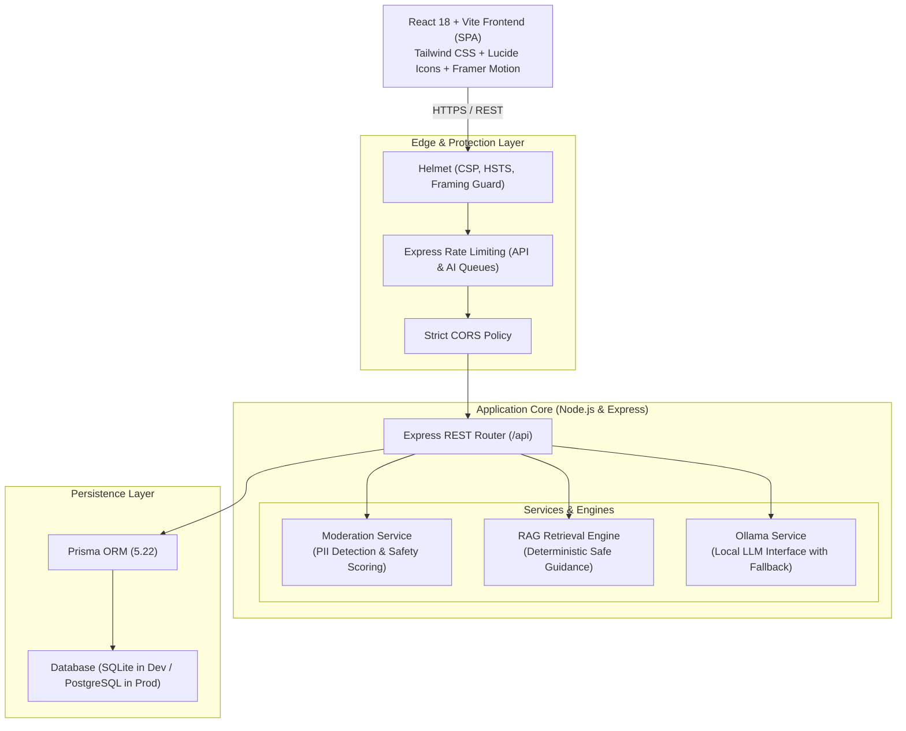

# Her Voice — System Architecture & Design Documentation 💜

> **Tagline:** “Your story matters. Your identity is yours to protect.”

---

## 1. High-Level Architectural Diagram

---

## 2. SOLID Principles in Practice

- **Single Responsibility Principle (SRP):**
  - `moderationService.ts`: Solely responsible for identifying personally identifiable information (phone numbers, addresses, emails, names) and evaluating post safety thresholds.
  - `ragService.ts`: Solely responsible for indexing trauma-informed knowledge documents and executing token matching.
  - `ollamaService.ts`: Solely responsible for LLM connectivity, prompt formatting, and fallback responses.
- **Open/Closed Principle (OCP):**
  - RAG knowledge entries can be added to the knowledge catalog without modifying the core matching algorithm.
- **Liskov Substitution Principle (LSP):**
  - Fallback and local LLM pipelines both conform to the same `ChatResponse` contract, enabling interchangeable use without frontend changes.
- **Interface Segregation Principle (ISP):**
  - Specialized TypeScript contracts for `Ngo`, `SafetyResource`, `MemorialStory`, and `PostWithDetails` prevent bloated payloads.
- **Dependency Inversion Principle (DIP):**
  - Environment variables, client origins, and database connection strings are decoupled via centralized configuration.

---

## 3. Data Structures & Algorithmic Complexity

| Operation | Component | Data Structure | Time Complexity | Space Complexity | Rationale |
| :--- | :--- | :--- | :---: | :---: | :--- |
| **PII Detection** | `ModerationService` | Regex Array Scanner | $O(N \times K)$ | $O(1)$ | $N$ characters in post, $K$ pattern rules. Linear scan prevents denial of service. |
| **RAG Retrieval** | `RagService` | In-Memory Token Set | $O(D \times T)$ | $O(D)$ | Fast sub-millisecond keyword relevance score calculation without external vector DB dependencies. |
| **Post Pagination** | `posts.routes.ts` | Indexed B-Tree (Prisma) | $O(\log M + K)$ | $O(K)$ | Limits payload size to $K=15$ items per batch, protecting browser memory. |
| **Interactive Simulator** | `SimulatorPlayer` | Directed Graph (DAG) | $O(1)$ | $O(V + E)$ | Finite state graph enabling instant branch switching based on survivor decisions. |

---

## 4. Security & Privacy Hardening

1. **Strict Anonymity:** No passwords, phone numbers, or real identities are required. Pseudonyms are generated locally using respectful botanical/celestial pairings (e.g., `ResilientCedar`, `CourageousOrchid`).
2. **Zero-PII Moderation Filter:** Scans and warns users before publication if sensitive data like phone numbers, pins, or addresses are detected.
3. **Helmet Protection:** HTTP security headers mitigate clickjacking, MIME sniffing, and cross-site scripting.
4. **Adaptive Rate Limiting:** Enforces strict 30 requests / 15 minutes on AI routes to prevent compute exhaustion.
5. **Quick-Exit Failsafe:** Universal floating escape button and double-Escape key shortcut immediately route away to Google Weather or educational portals while sanitizing browser tabs.

